# Prozesse oder Pleite

Ein Business-Spiel für Fernseher und Smartphone: Baue in 12 Monaten ein Unternehmen auf, das auch ohne dich läuft.
Gespielt wird mit der Fire-TV-Fernbedienung oder per Touch auf dem Android-Handy – allein oder im Duell zu zweit.

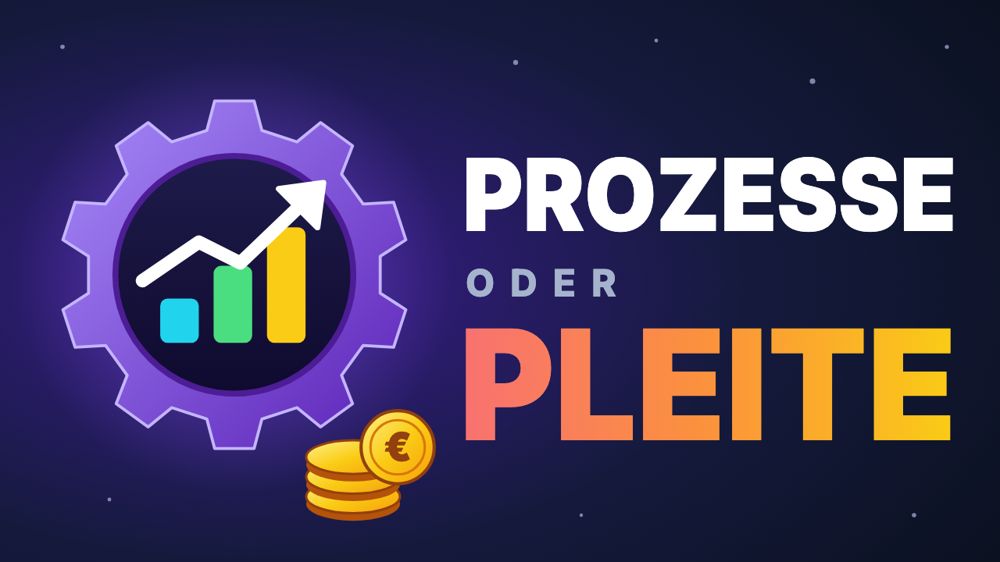

## Download

| Gerät | Datei |
|---|---|
| 📺 Fire TV / Android TV | [ProzesseOderPleite-FireTV.apk](https://github.com/chris86tian/prozesse-oder-pleite/releases/latest/download/ProzesseOderPleite-FireTV.apk) |
| 📱 Android-Smartphone | [ProzesseOderPleite-Mobile.apk](https://github.com/chris86tian/prozesse-oder-pleite/releases/latest/download/ProzesseOderPleite-Mobile.apk) |

Alle Versionen stehen unter [Releases](https://github.com/chris86tian/prozesse-oder-pleite/releases).

## Screenshots

| | |
|---|---|
| 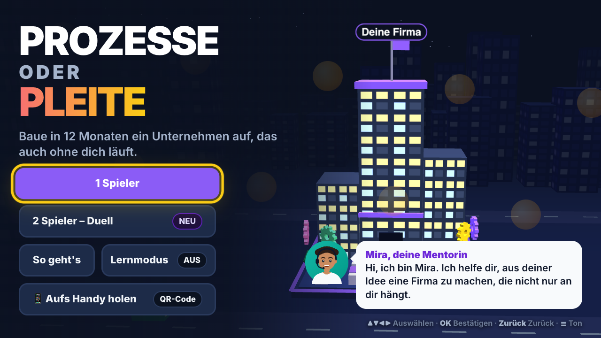 | 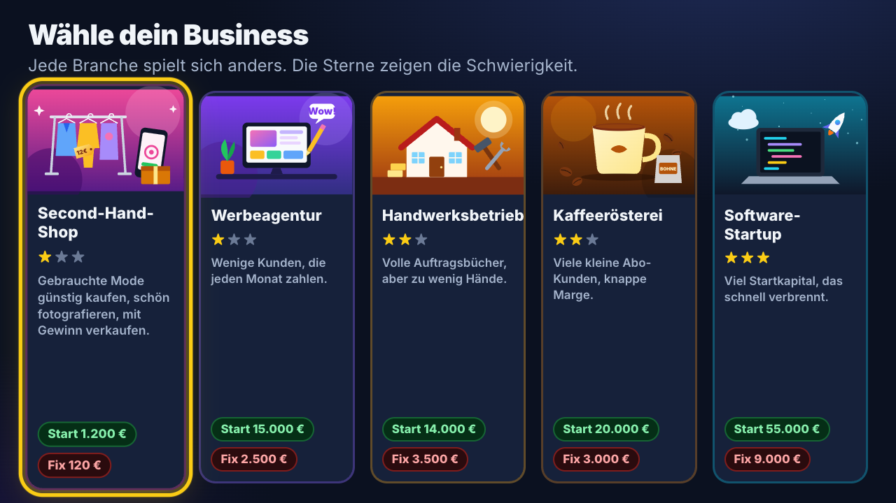 |
| **Titelbild** – die 3D-Stadt im Hintergrund | **Fünf Branchen** mit eigener Spielmechanik |
| 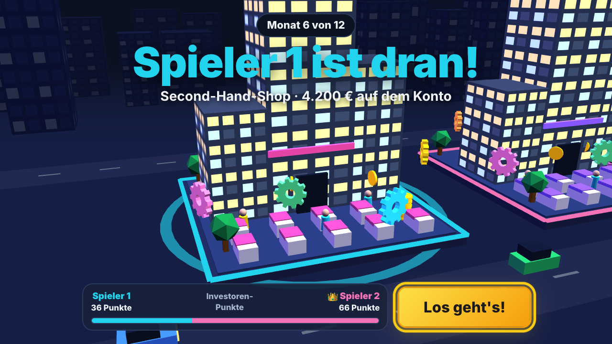 | 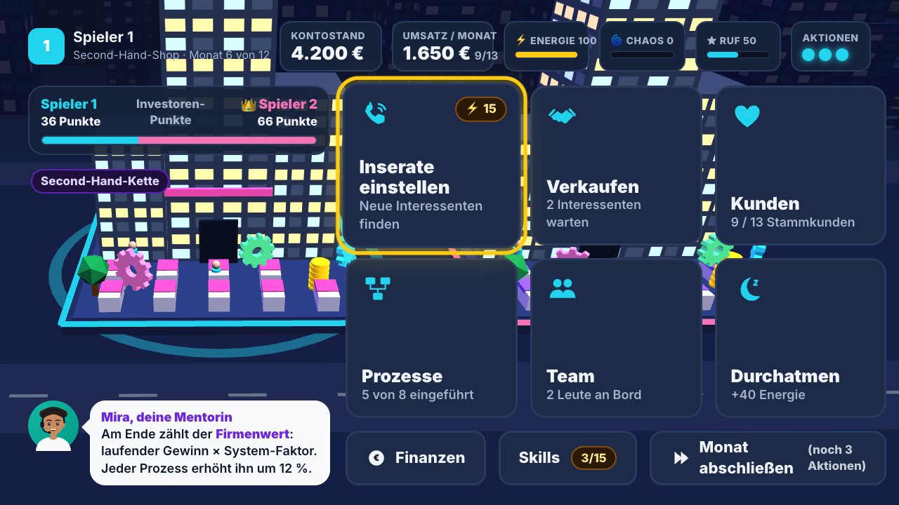 |
| **Duell** – die Kamera fliegt zur Firma, die dran ist | **Übersicht** – Gebäude, Zahnräder, Team und Kunden in 3D |
| 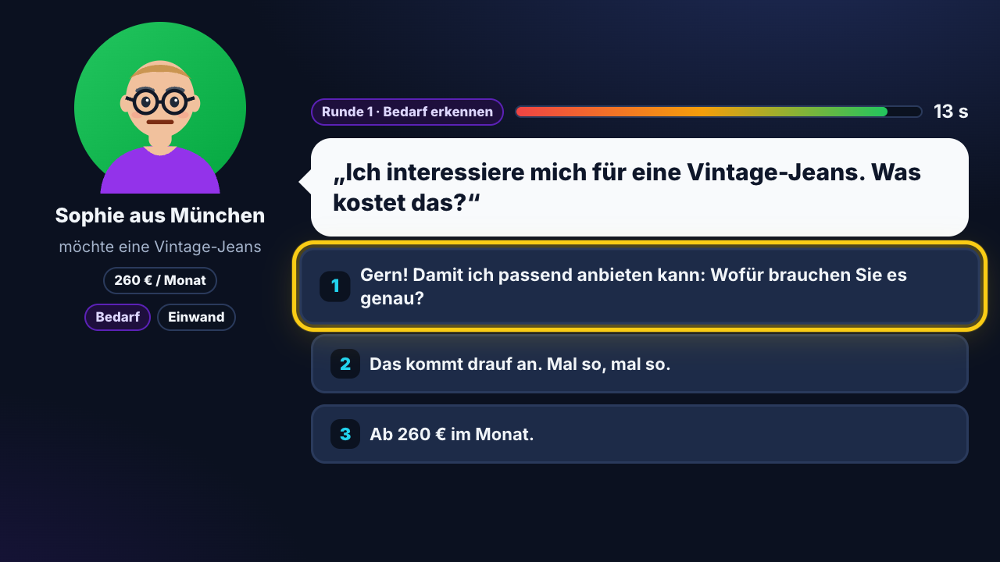 | 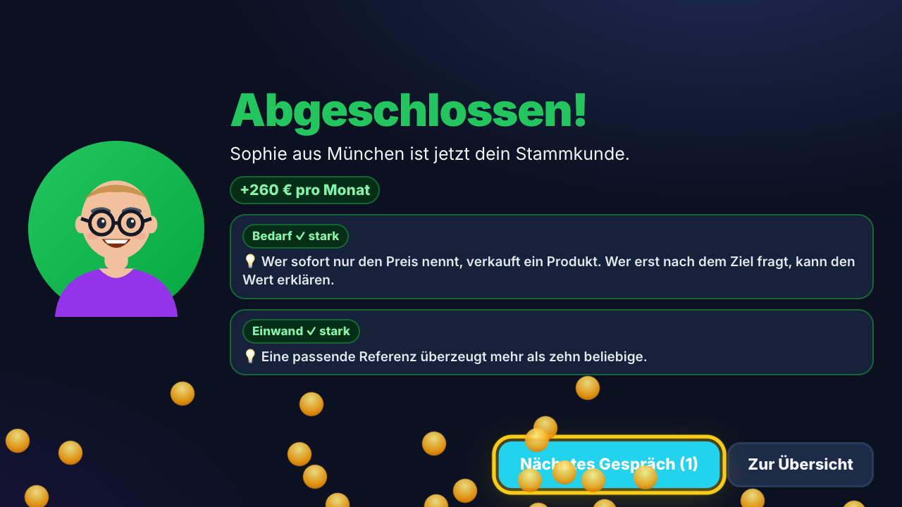 |
| **Verkaufsgespräch** – Bedarf erkennen, Einwand kontern | **Auswertung** – beste Antwort und warum |
| 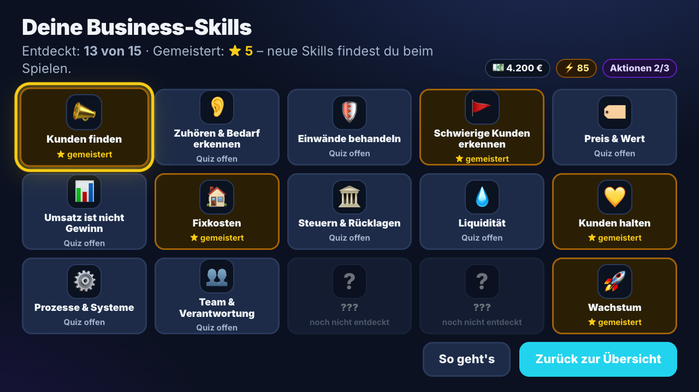 | 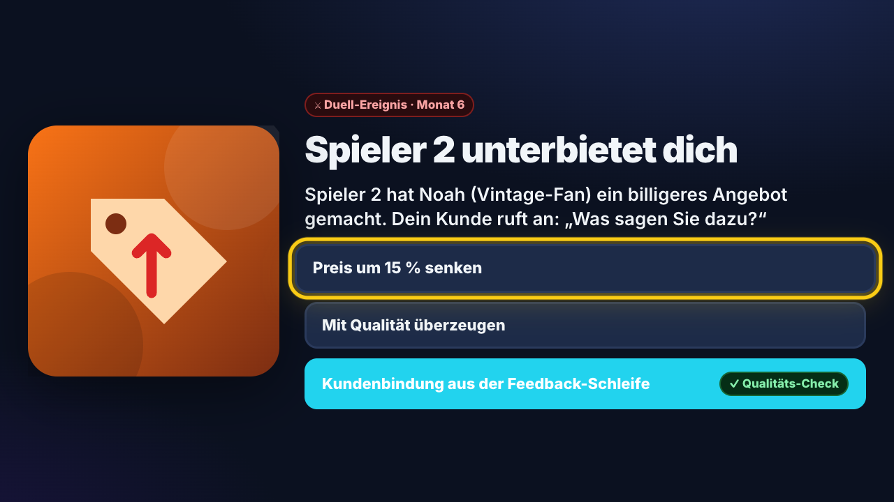 |
| **15 Business-Skills** zum Entdecken und Meistern | **Duell-Ereignis** – der Rivale unterbietet dich |
| 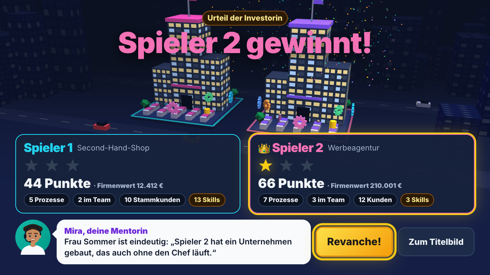 | 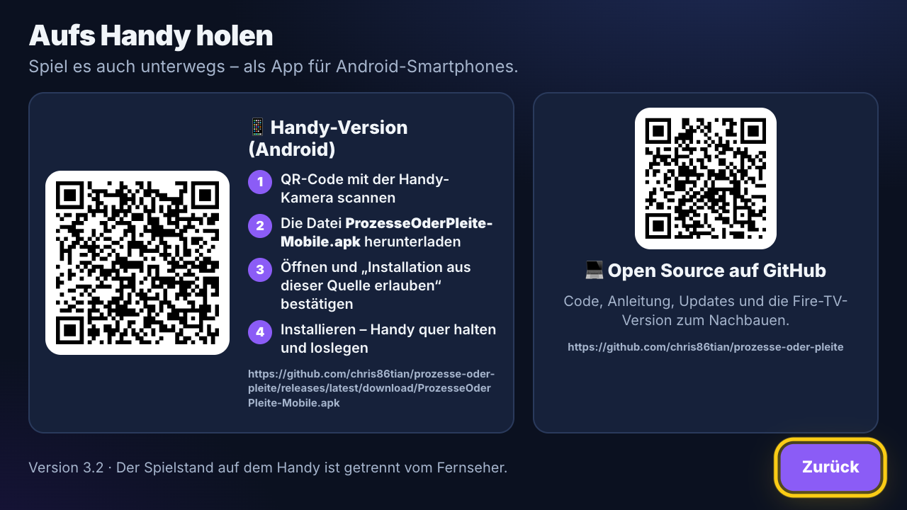 |
| **Urteil der Investorin** – faire Punkte je Branche | **Aufs Handy holen** – QR-Code direkt am Fernseher |

## Was steckt drin

- **5 Branchen:** Second-Hand-Shop, Werbeagentur, Handwerksbetrieb, Kaffeerösterei, Software-Startup – jede mit eigener Spielmechanik, eigenen Ereignissen und eigenem Schwierigkeitsgrad.
- **3D-Stadt (three.js):** Jede Firma ist ein Grundstück. Das Gebäude wächst von der Garage zur Firmenzentrale, Prozesse kreisen als Zahnräder, Mitarbeiter laufen übers Gelände, Kunden parken als Lieferwagen, Chaos lässt das Haus qualmen.
- **2-Spieler-Duell:** Abwechselnd je 3 Aktionen pro Monat. Duell-Ereignisse betreffen beide (Preiskampf, Abwerben, Kooperation). Am Ende entscheidet die Investorin mit fairen Punkten: Wie stark ist die Firma *für ihre Branche*?
- **Verkaufsgespräche in zwei Runden:** erst den Bedarf erkennen, dann den Einwand kontern – über 50 Fragen, jede mit Erklärung, warum die beste Antwort die beste ist.
- **15 Business-Skills:** Marge, Fixkosten, Steuern, Liquidität, Einwände, Prozesse … Jeder Skill wird beim Spielen entdeckt, kindgerecht erklärt und mit einer Quizfrage gemeistert.
- **Lernmodus:** doppelte Bedenkzeit bei allen Timern.
- **Bewährungsproben** in Monat 4, 8 und 12, eine Mentorin mit passenden Tipps, Spielstand wird automatisch gespeichert.

## Steuerung

| Fire TV | Handy | Funktion |
|---|---|---|
| Pfeiltasten | Tippen | Auswählen |
| OK oder ⏯ | Tippen | Bestätigen |
| Zurück | Zurück-Geste | Zurück / Pause |
| ☰ Menü | – | Ton an/aus |

## Installieren auf dem Fire TV

**Per ADB vom Rechner** (Fire TV: Einstellungen → Mein Fire TV → Entwickleroptionen → ADB-Debugging an):

```bash
adb connect <IP-des-Fire-TV>:5555
adb install -r ProzesseOderPleite-FireTV.apk
```

**Oder direkt am Fire TV** mit der App *Downloader*: den Download-Link der Fire-TV-APK eingeben und installieren.

## Installieren auf dem Android-Handy

1. Am Fernseher im Titelbild **„📱 Aufs Handy holen“** wählen und den QR-Code mit der Handy-Kamera scannen – oder oben den Link zur Mobile-APK öffnen.
2. `ProzesseOderPleite-Mobile.apk` herunterladen und öffnen.
3. Android fragt nach der Erlaubnis, Apps aus dieser Quelle (z. B. Chrome) zu installieren – erlauben.
4. Installieren und das Handy quer halten.

Die Handy-Version ist eine eigene App mit eigenem Spielstand und kann neben der TV-Version installiert sein.

## Im Browser spielen

Das Spiel ist eine reine Web-App ohne Server. Zum Ausprobieren am Rechner:

```bash
python3 -m http.server 8766 --directory game
```

Dann `http://localhost:8766` öffnen. Das Spiel passt sich an jede Fenstergröße an (Pfeiltasten + Enter oder Maus).

## Selbst bauen

Benötigt: JDK 17 und die Android-Build-Tools (`build-tools;34.0.0`, `platforms;android-34`). Gebaut wird ohne Gradle.

```bash
./build_apk.sh                               # baut FireTV- und Mobile-APK
FIRETV=<IP>:5555 ./build_apk.sh --install    # baut und spielt die TV-Version auf
```

Beim ersten Bau wird ein lokaler Signatur-Schlüssel unter `build/release.keystore` erzeugt (nicht im Repo). Updates lassen sich nur mit demselben Schlüssel über eine bestehende Installation spielen.

Screenshots neu aufnehmen (Chrome nötig): `node tools/screenshots.mjs`

## Aufbau

| Pfad | Inhalt |
|---|---|
| `game/data.js` | Branchen, Prozesse, Team, Ereignisse, Bewährungsproben |
| `game/learn.js` | Second-Hand-Shop, Verkaufsfragen mit Erklärungen, Business-Skills, Links |
| `game/engine.js` | Spiellogik ohne Oberfläche (auch in Node lauffähig) |
| `game/ui.js` | Bildschirme, Navigation per Fernbedienung und Touch, Duell, Sound, Spielstand |
| `game/scene3d.js` | 3D-Stadt mit three.js |
| `game/art.js` | Illustrationen als SVG |
| `android/AndroidManifest.xml` | App für Fire TV / Android TV |
| `android/AndroidManifest.mobile.xml` | App für Android-Smartphones (Querformat) |
| `tools/sim.js` | Balancing-Simulation: `node tools/sim.js 400 0.6` |
| `tools/screenshots.mjs` | Nimmt die Screenshots für dieses README auf |
| `tools/render_icons.sh` | Rendert Banner und App-Icon |

## Lizenzen

- [three.js](https://threejs.org) – MIT
- [QR Code Generator](https://github.com/kazuhikoarase/qrcode-generator) von Kazuhiko Arase – MIT
- [Inter](https://rsms.me/inter/) – SIL Open Font License
